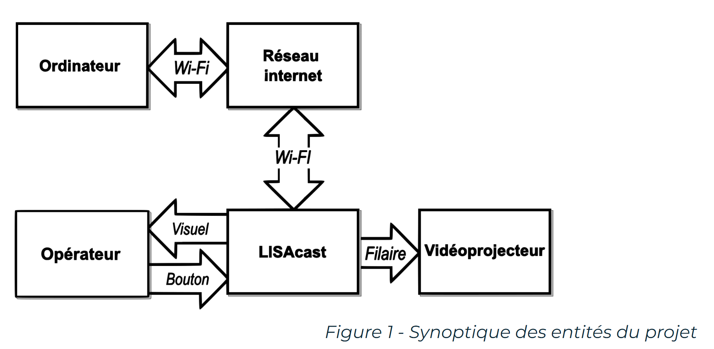

# Nano Cast – partage d'écran temps réel sur Raspberry Pi

Alternative open source à Chromecast et Miracast : on partage l'écran d'un PC vers un affichage public branché à une Raspberry Pi, en pair-à-pair WebRTC, sans serveur de streaming intermédiaire.

- **Latence d'environ 200 ms en 1080p**, là où un Chromecast est de l'ordre de 900 ms.
- Capture d'écran dans le navigateur, vidéo H.264 sur RTP reçue par un client C++ (libdatachannel) et décodée avec GStreamer.
- Signalisation par WebSocket (serveur Node.js), sélection du présentateur et contrôle d'accès gérés par la Raspberry Pi.



## Build et lancement

```bash
git submodule update --init --recursive --depth 1
cmake -S media-receiver-client -B media-receiver-client/build && make -C media-receiver-client/build -j2
(cd signaling-server-nodejs && npm install && node src/signaling-server.js)   # interface web : http://localhost:8001
./media-receiver-client/build/media-receiver-client
gst-launch-1.0 udpsrc address=127.0.0.1 port=5000 caps="application/x-rtp" ! queue ! rtph264depay ! video/x-h264,stream-format=byte-stream ! queue ! avdec_h264 ! queue ! autovideosink
```
**Stack :** C++17 · CMake · libdatachannel · WebRTC · GStreamer · Node.js · JavaScript
